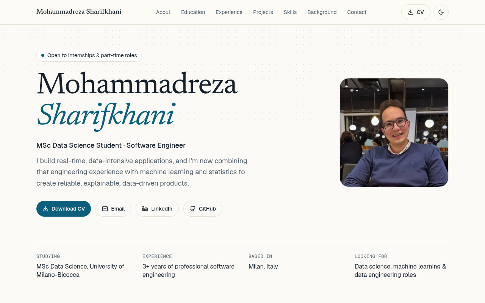

# Mohammadreza Sharifkhani — Portfolio

Personal website of an MSc Data Science student at the University of Milano-Bicocca and software engineer with 3+ years of experience building real-time, data-intensive applications.

**[msharifkhani.vercel.app](https://msharifkhani.vercel.app)** · [Download CV](https://msharifkhani.vercel.app/cv.pdf) · [LinkedIn](https://www.linkedin.com/in/msharifkhani/)

<picture>
  <source media="(prefers-color-scheme: dark)" srcset="docs/screenshot-dark.png">
  
</picture>

> Based in Milan and open to internships and part-time roles in data science, machine learning and data engineering. Get in touch at [Sharifkhani.mr@gmail.com](mailto:Sharifkhani.mr@gmail.com).

## Highlights

- **One source of content.** Every section renders from `lib/resume.ts`, so updating the site means editing one typed file.
- **Mostly static, little JavaScript.** The page is prerendered with React Server Components. Only the header, theme toggle, copy button and scroll reveal run on the client.
- **Light and dark themes.** Follows the system setting, remembers the visitor's choice and doesn't flash the wrong theme on load.
- **Responsive.** Checked for horizontal overflow from 320 px to 1600 px wide, with a dedicated mobile menu.
- **Accessible.** Skip link, semantic landmarks, visible focus styles, AA colour contrast in both themes, and support for `prefers-reduced-motion`. Content stays visible without JavaScript.
- **Ready to share.** Generated Open Graph image, JSON-LD `Person` data, sitemap, robots file and canonical URL.

## Tech stack

| Area      | Tools                                               |
| --------- | --------------------------------------------------- |
| Framework | Next.js 16 (App Router), React 19, TypeScript       |
| Styling   | Tailwind CSS 4 with CSS-variable design tokens      |
| Motion    | Framer Motion for scroll reveals, CSS for the hero  |
| Type      | Newsreader, Geist and Geist Mono through `next/font` |
| Icons     | Lucide                                              |
| Hosting   | Vercel                                              |

## Getting started

Requires Node.js 20.9 or newer.

```bash
git clone https://github.com/mosharif30/my-portfolio.git
cd my-portfolio
npm ci
npm run dev
```

Then open [http://localhost:3000](http://localhost:3000).

| Command         | Purpose                       |
| --------------- | ----------------------------- |
| `npm run dev`   | Start the development server  |
| `npm run build` | Create a production build     |
| `npm start`     | Serve the production build    |
| `npm run lint`  | Run ESLint                    |

## Updating the content

| To change                                | Edit                                 |
| ---------------------------------------- | ------------------------------------ |
| Profile, experience, projects, skills... | `lib/resume.ts`                      |
| SEO title, description, site URL         | `lib/siteConfig.ts`                  |
| CV download                              | Replace `public/cv.pdf`              |
| Portrait                                 | Replace `public/me.jpg` (square)     |
| Project thumbnails                       | Add to `public/projects/`            |
| Colours and fonts                        | Tokens at the top of `app/globals.css` |
| Navigation                               | `components/Layout/Header/HeaderItems.ts` |

In `lib/resume.ts`, wrap text in `**double asterisks**` to make it bold. A project without an `image` shows its `cover` text on a typographic panel, and the **Live site** button only appears when a project has a `url`.

## Project structure

```text
app/
  layout.tsx            Fonts, metadata, theme script, JSON-LD
  page.tsx              Section order
  globals.css           Design tokens and shared styles
  opengraph-image.tsx   Generated link-preview image
  robots.ts, sitemap.ts, icon.svg
components/
  Layout/               Header, footer, theme toggle
  UI/                   Section, Timeline, Reveal, Badge, Emphasis
  sections/             Hero, About, Education, Experience, Projects,
                        Skills, Background, Contact
lib/
  resume.ts             All page content
  siteConfig.ts         SEO and site settings
types/
  resume.ts             Content types
public/                 CV, portrait, project thumbnails
```

## Deployment

The site is a standard Next.js app and needs no environment variables. On [Vercel](https://vercel.com), import the repository and keep the default settings. If you deploy it to a different domain, update `url` in `lib/siteConfig.ts` so the canonical link, sitemap and preview image point to the right place.

## Reusing this project

You're welcome to fork it as a starting point for your own site. Please replace the personal content first: `lib/resume.ts`, `lib/siteConfig.ts`, the CV, the portrait and the project thumbnails.
